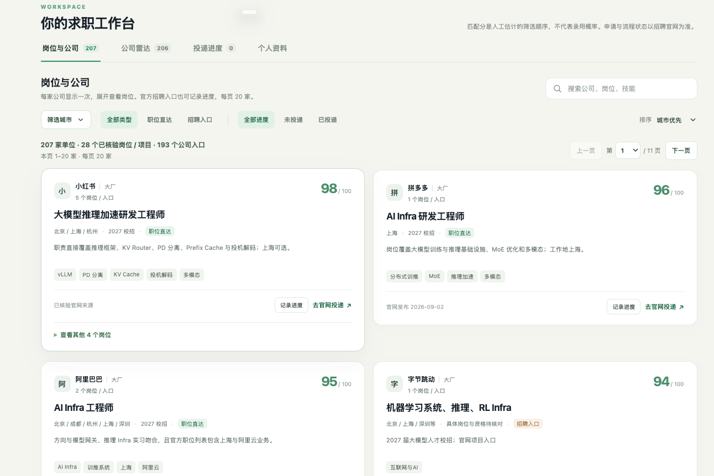

# AI Infra 求职网站 · 招聘大全

一个面向 AI Infra / 大模型工程方向的 2027 校招求职工作台。

**在线访问：[AI Infra 求职工作台](https://supertanziang.github.io/ai-infra-job-hub/)**

GitHub Pages 入口提供公开访问。切换域名时，原站点中的投递记录和资料保险箱需要分别导出、导入；浏览器不会自动跨域同步。

> 把分散在招聘官网里的机会，整理成一张可以筛选、比较、记录进展的求职地图。



截至 2026-10-26，当前目录包含 **207 家单位**、**206 家公司与研究院所雷达**、**33 个已核验岗位 / 招聘项目**，主列表另有 **192 个公司入口**。数据重点覆盖互联网大厂、央国企、外企、芯片厂、车企、机器人公司、研究所，以及武汉本地的研究院所和成长型企业。

## 本地运行

在项目目录执行：

```sh
python3 -m http.server 8766 --directory dist
```

浏览器打开 [http://localhost:8766](http://localhost:8766)。请通过 HTTP 服务访问，以便正常加载岗位 JSON；资料保险箱需要 HTTPS 或 localhost 下的 Web Crypto。

## 主要功能

- 全公司主列表按单位去重，同一公司展开查看岗位；岗位、公司雷达、进度列表每页最多 20 家。
- 支持地区与研究院所、央国企、创业 / 成长、外企等类别组合筛选，以及关键词和匹配度排序。
- 打开官方职位页或招聘入口；需要在招聘官网自行登录、填写资料和提交申请。
- 手动记录已投递、笔试、面试、Offer 等阶段，查看进展时间线，设置下一步跟进日期及备注。
- 投递记录导出 v2 JSON，兼容导入 v1/v2 并合并历史；个人资料保险箱使用独立 v1 加密备份格式。

## 这套目录有什么用

- **城市优先**：上海、北京、杭州、深圳、苏州、武汉、西安，并保留其他城市机会。
- **公司去重**：同一家公司只展示一次，多岗位在公司卡片内展开。
- **匹配度排序**：按 AI Infra、推理系统、训练系统、KV Cache、MoE、Agent、端侧推理和芯片软件等方向人工排序。
- **进度看板**：按待投递、已投递、笔试、面试、Offer、已结束六个阶段查看公司进度。
- **岗位时间线**：每个岗位独立记录投递、笔试、一面、二面、Offer 等事件，并设置下一步日期和待办。
- **一键定位官网**：卡片直接打开官方职位页、招聘项目页或公司招聘入口；最终提交仍由求职者在招聘官网完成。

## 数据保存

投递记录和时间线保存在当前浏览器的 `localStorage`。个人资料与简历文件通过 Web Crypto 使用 PBKDF2-SHA256（240,000 次迭代）派生密钥、AES-256-GCM 加密后保存在当前浏览器的 IndexedDB；保险箱密码不持久化保存。密码遗失后无法解密备份。投递记录导出为 v2 JSON，兼容导入 v1/v2。

网页不会自动读取 HR 流程、招聘网站账户或邮箱，也没有跨设备自动同步。请在招聘官网确认状态后手动更新进度；换设备、换域名、换本地端口或清理浏览器数据前，分别导出投递记录和加密资料备份。投递记录导出为明文，个人资料备份保持加密。

## 岗位与来源

- `dist/jobs.json`：公开岗位、官方招聘入口及筛选元数据。
- `COMPANY_SOURCES.md`：公开来源与核验说明。
- `UPDATING.md`：数据维护方式。

职位直达、招聘项目入口和官网关注入口分别标记；机构地址不等于所有职位的工作地。匹配分是人工估计的关注顺序，不代表录用概率。职位开放状态、校招届别、学历和工作地以招聘官网为准；刷新网页只是重新读取已发布的数据，不会自动抓取全网招聘信息。

## 发布

GitHub Pages 使用 `.github/workflows/pages.yml` 自动发布 `dist/`。将公开站点文件推送到 `main` 后即可更新，也可在 Actions 手动运行。Sites 的每日更新和 GitHub 仓库是两个发布目标；更新数据后需将最新 `dist/jobs.json` 同步到本仓库，GitHub Pages 才会更新。

将 `dist/` 作为静态网站目录部署即可。公开仓库与站点仅发布代码和公开招聘数据；个人简历、资料备份、投递记录、招聘网站密码及其他凭据不得提交到仓库。浏览器内保存的个人数据不会自动写入项目文件或上传到 GitHub。
